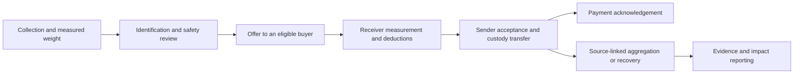
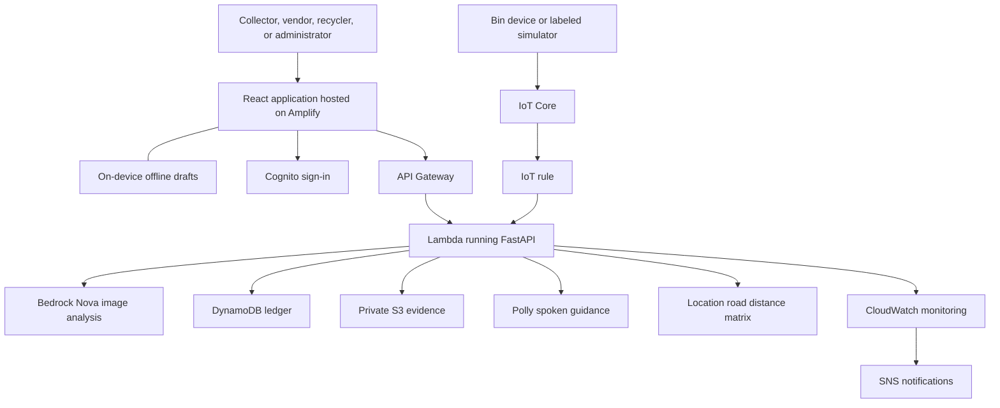

# ScrapSetu

### Fairer prices. Safer handovers. Traceable recovery.

ScrapSetu is a platform for informal waste collectors, scrap vendors, and recyclers to identify materials, agree on transparent terms, and follow each lot from collection to recorded recovery. It brings photo-based AI assistance, offline data capture, and a shared transaction history into a workflow built around the people who handle waste every day.

For the **Waste and Energy** track, our idea connects the social challenge of an underserved workforce with the environmental challenge of recovering useful materials. Better information at collection, clearer accountability at handover, and evidence at recovery can make the value chain more useful to everyone involved.

## The Problem

A collector can recover valuable material without having reliable information about its grade, a comparable price, or a suitable buyer. A receiver may weigh it differently or apply deductions, while neither party has a clear record of what was agreed. Once material changes hands or enters a larger batch, its origin can become difficult to follow.

Hazardous items add another layer of risk. Damaged batteries, chemical leaks, and pressurized containers require careful assessment. At the same time, limited literacy, basic phones, and unreliable connectivity make many digital tools difficult to use in the field.

These gaps affect both livelihoods and environmental accountability. Collectors need usable information and records, while the recycling chain needs evidence of what was actually recovered.

## Our Solution

ScrapSetu gives each material lot a record that stays connected to its journey. The record begins with a description, photograph when available, and measured weight. It develops through an offer, receiver inspection, sender acceptance, payment acknowledgement, and recovery reporting.

The collector remains involved in decisions that affect the transaction. A receiver can propose a different weight or a deduction, but the sender must accept the final terms before custody changes. Payment is recorded separately, with the seller acknowledging receipt.

The result is a common record that both sides can refer to, rather than an agreement that disappears after the material leaves the collection point.

## Who Benefits

| Participant | Value ScrapSetu provides |
|---|---|
| **Collectors** | Material identification support, indicative price comparisons, eligible buyer information, offline drafts, and a record of earnings and agreed terms. |
| **Vendors and aggregators** | Structured intake, available inventory, and source-linked aggregation when smaller lots are combined. |
| **Recyclers** | Facility profiles, documented handovers, recovery evidence, and a clearer connection between incoming material and reported output. |
| **Administrators** | A shared workflow for reviewing permits and uncertain materials, maintaining reference data, and resolving supported disputes. |

## What the Prototype Does

### Helps Collectors Identify Materials and Recognize Risk

Photo analysis through Amazon Bedrock classifies waste into seven categories: biodegradable, recyclable, reusable, e-waste, hazardous, mixed, and unknown. It identifies potential hazards and combines them with observations reported by the collector.

Uncertain or hazardous entries require documented review before sale. The system uses separately entered scale readings for quantity. An image provides identification assistance, not proof of weight or material purity.

### Makes Prices and Deductions Visible

Collectors can view indicative reference prices and buyer information alongside an offer's unit rate and disclosed fee. Sourced price entries include their origin and observation time. A rule-based notice flags large deviations from a recent reference for further discussion.

Receiver weight, contamination deductions, and the final payable amount remain visible to the seller. This gives both parties a concrete basis for agreeing on the transaction.

### Records Both Sides of a Handover

Signed, expiring QR tokens connect a handover to its intended receiver. The receiver records the measurement, the sender accepts the terms, and the application records the custody change. Replay protection prevents the same token from completing the handover twice.

The buyer can then report a payment, which the seller separately acknowledges. Receipts and event history preserve the agreement for later reference.

### Preserves Material History Through Aggregation

When a vendor combines compatible lots, ScrapSetu records how much came from each source and reduces the available source quantities accordingly. The new batch retains those relationships instead of starting with an unrelated history.

At recovery, the recycler supplies evidence and records recovered output alongside residue or process loss. Those quantities must reconcile with the available input.

### Supports Work in Areas with Poor Connectivity

Collectors can save drafts on their device and synchronize them when connectivity returns. Stable operation identifiers prevent retries from creating duplicate acknowledged records. The built application also supports offline reopening after it has been loaded and the user has signed in online.

Prepared Hindi and English audio guidance supports users who benefit from spoken instructions. The mobile interface brings collection tasks together, while administrative functions remain in the relevant role's workspace.

## An Illustrative Material Journey

A collector records a 10 kg lot and agrees on a rate of INR 100 per kilogram. At intake, the recycler records 10 kg received and proposes a 1 kg contamination deduction. With no additional fee, the final offer is INR 900.

The collector sees and accepts the revised terms before the handover is confirmed. The original 10 kg reading remains part of the history, and payment is acknowledged separately. If the recycler later reports 8 kg recovered and 1 kg of residue from the 9 kg available input, the recovery record reconciles to that input.

This example shows how ScrapSetu connects a commercial agreement to a material outcome. It is an illustration of the workflow, not a claim about an actual collection or recovery result.

## What Makes the Approach Distinctive

### Collector Participation Continues After Collection

The collector can review the final measurement and amount rather than losing visibility at the point of delivery. Earnings and transaction history connect the physical handover to its financial outcome.

### Accountability Survives Changes in Ownership and Batch Size

Custody records, original measurements, and source allocations connect the stages of the value chain. This matters when material moves through vendors before reaching a recycler.

### AI Assistance Is Connected to Practical Decisions

Identification feeds into review and handling decisions. Measured quantities, facility eligibility, and human acceptance govern the transaction. Uncertainty remains visible instead of becoming a confident commercial claim.

### Impact Begins with Recorded Recovery

Collection, handover, and recovery are distinct events. Energy estimates depend on reported recovery quantities and documented factors, giving reviewers a way to understand the basis of an estimate.

## Architecture

ScrapSetu uses a React and TypeScript frontend with a FastAPI backend. The browser stores offline drafts, while the backend enforces identity, custody, transaction state, and evidence access. The AWS deployment design connects these functions to managed identity, storage, inference, and operational services.

The local pilot uses SQLite and local evidence storage, with cloud services enabled through configuration. The diagram represents the AWS deployment design implemented in the repository; full cloud operation still requires deployment and live verification.

## How AWS Supports the Solution

Each AWS integration has a specific role in the material journey or its operation.

| AWS service | Role in ScrapSetu | Implementation reference |
|---|---|---|
| **Amazon Bedrock** | Uses Amazon Nova Lite through the Converse API for image-based classification and hazard identification. The default model is `amazon.nova-lite-v1:0`. | [AI triage](backend/app/services/ai_triage.py) and [configuration](backend/app/config.py). |
| **Amazon DynamoDB** | Stores lots, custody states, transactions, reference data, and audit events. Atomic writes and a conditional revision lock protect against conflicting updates and duplicate allocation of available stock. | [Ledger storage](backend/app/platform/store.py). |
| **Amazon S3** | Holds private collection and recovery images. The backend controls uploads and authorized retrieval; the deployment template enables encryption, versioning, and blocked public access. | [Evidence storage](backend/app/platform/media.py) and [infrastructure](infrastructure/template.yaml). |
| **Amazon Cognito** | Provides hosted sign-in and identity validation for collector, vendor, recycler, and administrator roles. The browser uses authorization-code PKCE. | [Authentication](backend/app/platform/auth.py) and [browser workflow](frontend/src/workflow.ts). |
| **AWS Lambda and Amazon API Gateway** | Run the FastAPI workflow through Mangum and expose HTTP endpoints with configured CORS and throttling. Lambda also handles events from the IoT rule. | [Lambda adapter](backend/app/lambda_handler.py) and [infrastructure](infrastructure/template.yaml). |
| **AWS IoT Core** | Receives bin readings on `scrapsetu/bins` and passes them to Lambda. Validated weight and fill readings support threshold flags and collection planning. | [Fleet integration](backend/app/platform/fleet.py) and [infrastructure](infrastructure/template.yaml). |
| **Amazon Polly** | Converts prepared Hindi and English welcome, safety, and receipt guidance into cached audio using the Aditi voice and standard synthesis engine. | [Audio generation](backend/app/platform/media.py). |
| **Amazon Location Service** | Supplies truck-road distance matrices for capacity-constrained route planning and comparison with a baseline. | [Route planning](backend/app/platform/fleet.py). |
| **AWS Amplify Hosting** | Provides the configured hosting destination for the built React application, including single-page application routing. | [Hosting resources](infrastructure/template.yaml). |
| **Amazon CloudWatch and Amazon SNS** | Provide Lambda logs and error-alarm email notifications. The template also includes a separate AWS Budgets cost notification. | [Monitoring resources](infrastructure/template.yaml). |

The repository contains the application integrations and deployment resources. Their presence establishes implementation, while successful operation in an AWS account must be demonstrated separately. Explicit sample analysis and simulated telemetry remain labeled.

## Relevance to the Waste and Energy Track

### Making Material Recovery Accountable

ScrapSetu records where material came from, how its quantity changed through handovers, and what the recycler reported as recovered. Source allocations retain provenance when lots are combined, and recovery records require a mass balance:

**Recovered output + residue or process loss = available input.**

This provides a basis for reviewing reported recovery and identifying gaps in the chain. It also prevents an aggregated lot from being counted as newly collected material in the collection total.

### Connecting Recovery to Energy Estimates

The application can estimate the energy difference associated with recovered material using documented virgin-production and secondary-production factors:

**Estimated avoided energy = recovered mass × (virgin production energy per kg − secondary production energy per kg).**

Each factor includes a source, geography, year, lifecycle boundary, and uncertainty description. Recovery records retain the factor version used at the time. Where no factor exists, the system leaves the outcome unestimated rather than assigning an unsupported benefit.

### Exploring More Efficient Collection

The fleet extension uses bin fill levels and weights to plan compatible loads within vehicle capacity. It compares routes for the same stops and depot, using Amazon Location road distances when enabled. Any resulting energy comparison uses an explicit vehicle-consumption assumption and remains separate from recovery estimates.

These capabilities make impact assessable. They do not yet establish measured energy savings or independently verified environmental outcomes.

## Current Prototype and Path Forward

The local prototype implements the core collection, review, handover, payment acknowledgement, aggregation, recovery, and offline synchronization workflows. It also includes AWS service integrations, a deployment template, and a fleet extension with labeled simulated telemetry.

The next milestone is validation with collectors and recycling partners alongside a complete AWS deployment. That work should establish whether the interface is usable on basic devices, whether price information improves decisions, and whether recovery evidence can be reconciled with partners' operational records.

Several boundaries remain important. Facility authorization is based on administrator review of supplied information. Payments are acknowledged by the parties rather than verified through a bank. Recovery is recycler-reported, and internal receipts are not official EPR certificates. The current DynamoDB design is intended for a small pilot and will need different access patterns for larger-scale use.

These are the practical questions the next stage must address before wider adoption.

## Conclusion

ScrapSetu puts the collector's transaction and the material's recovery into the same record. Its purpose is to make prices easier to understand, handovers easier to account for, and recovery outcomes easier to examine.

By combining accessible collection tools with AWS-supported intelligence and traceability, the project offers a practical foundation for a more accountable recycling chain. The long-term goal is a system in which the people recovering valuable materials have better information, a clearer voice in each transaction, and a lasting record of the value they help create.
