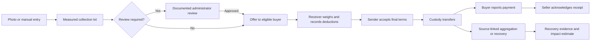
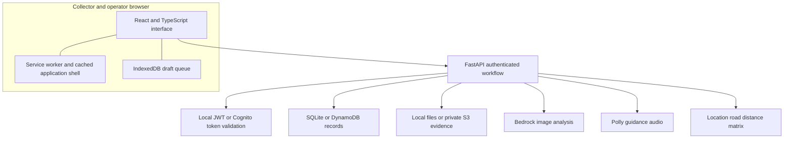
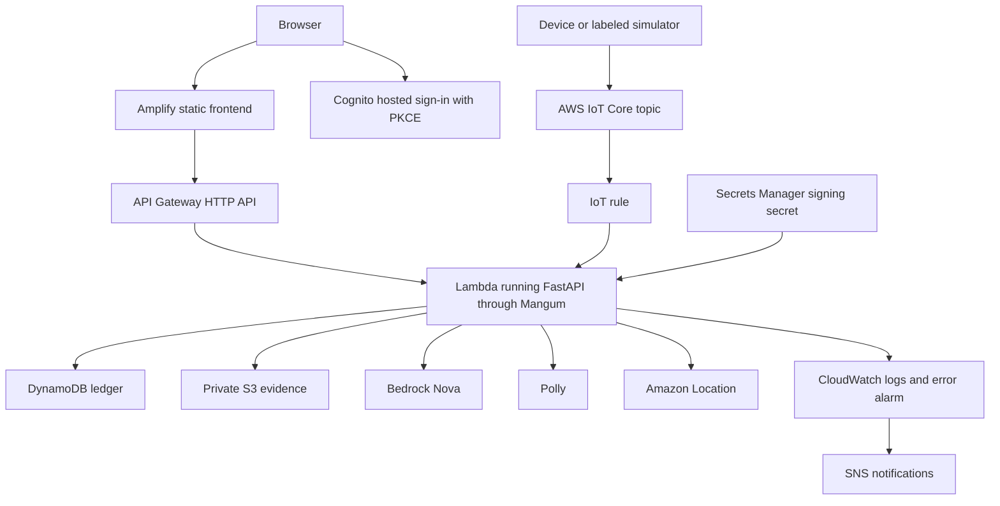
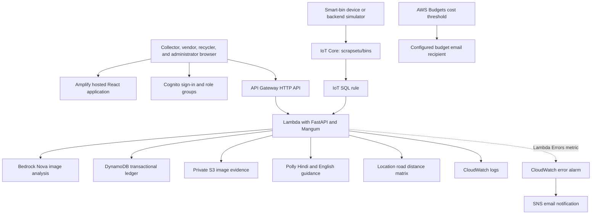

# ScrapSetu

### Fairer prices, safer handovers, and traceable material recovery

ScrapSetu connects informal waste collectors, scrap vendors, and recyclers through a shared record of what was collected, what was agreed, who received it, and what was recovered. It combines photo-based material identification with measured weights, transparent offers, two-party handover confirmation, and offline collection drafts.

Built for the **Waste and Energy** hackathon track, the project addresses two connected challenges: making the scrap value chain more accountable and making recovery outcomes measurable. Its goal is to give collectors better information and usable records while helping downstream buyers manage intake, evidence, and material history.

**Project status:** A working local pilot with AWS integrations and a SAM deployment template. The repository documents local automated verification. It does not establish that the complete AWS stack has been deployed or that every AWS integration has been verified live.

## Contents

- [The Problem](#the-problem)
- [Our Approach](#our-approach)
- [Who Uses ScrapSetu](#who-uses-scrapsetu)
- [Core Capabilities](#core-capabilities)
- [The Material Journey](#the-material-journey)
- [System Architecture](#system-architecture)
- [How AWS Is Used](#how-aws-is-used)
- [Technology Stack](#technology-stack)
- [Run Locally](#run-locally)
- [Environment Configuration](#environment-configuration)
- [Demo and Video Walkthrough](#demo-and-video-walkthrough)
- [Waste and Energy Accounting](#waste-and-energy-accounting)
- [API Overview](#api-overview)
- [Testing and Verification](#testing-and-verification)
- [Deploy to AWS](#deploy-to-aws)
- [Repository Structure](#repository-structure)
- [Current Limitations and Next Steps](#current-limitations-and-next-steps)
- [Troubleshooting](#troubleshooting)

## The Problem

Collectors are the first link in material recovery, but they often work with limited information and little transaction evidence.

| Challenge | Why it matters |
|---|---|
| Unclear prices | Collectors may not know how an offer compares with an indicative reference or how deductions affect the final amount. |
| Difficult recycler access | Finding a nearby buyer is not enough. The facility must accept the material, meet quantity requirements, and have suitable authorization. |
| Undocumented handovers | Missing records make it difficult to reconcile weights, resolve disputes, or establish where material went next. |
| Hazardous handling | Damaged batteries, chemicals, pressurized containers, and unknown electronics require specialist assessment. |
| Limited digital access | Unreliable internet, basic Android devices, and literacy barriers can make conventional business software difficult to use. |
| Unsubstantiated impact claims | Collection alone does not prove recovery or energy savings. Those claims need recorded outcomes and disclosed assumptions. |

## Our Approach

ScrapSetu makes the material lot the central record connecting the entire journey. Identification helps a collector describe an item. Actual scale readings determine its recorded quantity. An offer captures the rate and fee. The receiver proposes measured terms, and the sender accepts them before custody changes. Recovery is recorded later with evidence and a mass balance.

This creates a practical basis for price comparison, accountability, and outcome reporting. The application is designed to support better decisions without presenting an image classification as a material assay, a payment report as a bank confirmation, or an estimated benefit as measured energy savings.

The intended value is straightforward:

- **Collectors** gain clearer offers, an earnings record, and collection drafts that survive a loss of connectivity.
- **Vendors** gain inventory records and source allocations that remain connected when lots are aggregated.
- **Recyclers** gain structured intake, facility details, and recovery records linked to their source material.
- **Operators** gain a consistent workflow for reviews, disputes, reference data, and collection planning.

## Who Uses ScrapSetu

| Role | Main responsibilities |
|---|---|
| Collector | Identify materials, record measured lots, compare buyers, request pickups, accept handover terms, and acknowledge payment. |
| Vendor | Receive material, manage available stock, aggregate compatible source lots, and arrange onward sales. |
| Recycler | Maintain facility information, receive eligible material, report payments, and record recovery with supporting evidence. |
| Administrator | Review lots and facility permits, maintain reference prices and energy factors, resolve supported disputes, and operate the fleet extension. |

Local development provides one demonstration account for each role. Cloud authentication uses Cognito users assigned to exactly one application group.

## Core Capabilities

### Material Identification and Safety Review

Uploaded photographs are analyzed through Amazon Bedrock using the configured Nova model. The backend validates the image and model response, records inference provenance, and reports provider failures explicitly. It does not substitute a confident sample answer when live inference fails.

Collector-reported hazards are combined with detected hazards. Uncertain, hazardous, mixed, or otherwise review-required results must pass a documented review before a sale can proceed. Hazard flags remain attached to the lot after review, and hazardous handovers require the additional specialist scope represented in the pilot catalog.

Explicit sample items are available for demonstrations without AWS credentials. Their results remain labeled as demo data. Images do not establish weight or certify material purity.

### Transparent Offers and Earnings

The material catalog uses stable material IDs and rates in INR per kilogram. Reference prices can carry a source and observation timestamp. Until sourced prices are entered, the default rates are labeled illustrative.

Offers record the unit rate and a disclosed total fee. Receiver measurements and contamination deductions are presented to the seller before acceptance. Offers more than 30 percent above or below a reference observed within the last seven days receive a price-deviation notice. This is a rule-based signal for review, not a fraud verdict or a trained anomaly detector.

The earnings view distinguishes acknowledged money received from pending amounts.

### Two-Party Handovers and Payment Records

Handover QR tokens are signed, expire after two hours, and are bound to the named receiver. Reissuing a token invalidates the previous token, and successful redemption cannot be applied twice.

The buyer records the received weight and deductions. The seller then accepts the final terms. Payment is a separate step: the buyer reports payment and the seller acknowledges receipt. Supported workflows also include cancellation before confirmation, disputes, documented administrator resolution, and downloadable JSON receipts.

### Traceability and Recovery

History is built from recorded events rather than synthetic examples. Original and receiver measurements remain available. Aggregation debits source quantities and records the allocations feeding the new lot.

Recycler recovery records require evidence and a balance between recovered output, residue or process loss, and available input. Evidence access is restricted to authorized users through the API. Internal receipts do not represent official EPR certificates.

### Collector Access and Offline Capture

The frontend provides a mobile layout, photo capture, English and Hindi audio guidance, and a service worker for the built application. Drafts, including photos when supplied, are stored in IndexedDB and separated by account.

After reconnecting, stable operation IDs allow retries without duplicating an acknowledged server operation. A draft is removed only after successful synchronization. Rejected drafts remain visible for retry. The app must be loaded and the user signed in online before offline use; live AI, handover confirmation, and payment updates require connectivity.

### Partner Discovery, Pickups, and Fleet Planning

Buyer matching considers material acceptance, minimum quantity, permit review, expiry, and straight-line distance. Vendors and recyclers maintain their own facility details. Changing those details invalidates the previous verification.

Pickup requests have a separate acceptance and completion workflow. The optional fleet extension accepts bin telemetry, labels simulated readings, rejects stale updates, and selects recent bins at or above an 80 percent fill threshold. It plans trips for a selected material within vehicle capacity, using either straight-line estimates or Amazon Location road distances. The route algorithm is a heuristic with a comparison baseline, not a guarantee of an optimal route.

## The Material Journey



Custody and payment are related but separate records. A confirmed handover does not automatically mean the seller has been paid.

For example, with no additional fee:

```text
Sender weight:             10 kg
Receiver weight:           10 kg
Contamination deduction:    1 kg
Effective payable weight:   9 kg
Agreed rate:              100 INR/kg
Final payable amount:     900 INR
```

The original 10 kg reading remains recorded. The system does not silently overwrite it with the effective 9 kg quantity.

## System Architecture

### Application Layers

The same React frontend and FastAPI business workflow support both local and AWS-backed operation. Configuration selects the authentication, ledger, evidence storage, and optional cloud services.



### Local Execution

The frontend runs through Vite on port `5173`. Requests to `/api` are proxied to FastAPI on port `8001`. SQLite stores the ledger, and evidence files are kept under the backend data directory. AWS features can be enabled individually, so live Bedrock identification can be demonstrated without deploying the rest of the platform.

### AWS Deployment Design



This diagram describes the repository's configured deployment design, not proof of an already running cloud environment. The simulator's IoT publish is performed by the backend when an IoT endpoint is configured.

### Data Integrity and Access Control

- Authenticated identities determine the actor. Request bodies cannot simply nominate another user as the current actor.
- Roles, transaction participation, and current custody control sensitive operations.
- Persistent mutations use idempotency keys; applicable record updates also require the current version.
- SQLite changes commit atomically. DynamoDB changes use transactional writes with a conditional global revision and consistent-read checks.
- Audit events are append-only through the application API. This is not an independently tamper-proof ledger.
- Private photos are served through authorized evidence endpoints.

The DynamoDB adapter is deliberately designed for a small pilot. It reads one partition and serializes writes through a revision lock. Larger deployments require redesigned access patterns and indexes.

## How AWS Is Used

AWS supports the material journey from photo identification and authenticated handover to evidence storage, recovery records, and collection planning. The following breakdown maps each integration to the code that implements it.

**Status terminology:** An implemented integration means the repository contains its SDK calls, authentication logic, or deployment resources. It does not establish that the service is deployed and verified live in an AWS account.

### High-Level AWS Architecture



The frontend sends authenticated requests to the API, while cloud credentials and service calls remain in the backend. The diagram represents the implemented deployment design; devices and cloud resources still require account-specific configuration.

### 1. Amazon Bedrock: Multimodal Material Identification

**Configured model:** Amazon Nova Lite, `amazon.nova-lite-v1:0`.

**Code references:** [ai_triage.py](backend/app/services/ai_triage.py), [config.py](backend/app/config.py), and [triage schemas](backend/app/schemas/triage.py).

The backend uses the Bedrock Converse API to analyze uploaded field-camera images. Prompt-based classification maps results into seven categories: biodegradable, recyclable, reusable, e-waste, hazardous, mixed, and unknown.

Analysis includes hazard indicators such as battery damage, chemical leaks, and pressurized containers. Model output is validated and combined with collector-reported hazards before applying review requirements. The workflow requires separately entered scale measurements instead of inferring commercial weight from a photograph.

`BEDROCK_MODEL_ID` selects the model used for an invocation. The current configuration does not establish a second active Claude 3.5 Sonnet integration or an automatic model fallback. Explicit sample results are labeled separately from live inference.

### 2. Amazon DynamoDB: Transactional Ledger and Chain of Custody

**Service:** Managed NoSQL storage for application records.

**Code reference:** [store.py](backend/app/platform/store.py).

The DynamoDB adapter stores material lots, handover and payment states, audit events, reference prices, and idempotent operation records. Mutations are committed using `transact_write_items`, with a conditional `_revision` record acting as a global optimistic lock.

The adapter checks the revision before and after consistent reads and rejects conflicting commits. Combined with application-level custody, version, and allocation checks, this prevents concurrent operations from independently consuming the same available stock.

This is a small-pilot design using one partition and serialized writes. It is not a claim of unlimited throughput or race-condition safety outside the implemented transaction boundaries. Local mode uses SQLite instead.

### 3. Amazon S3: Private Evidence Storage

**Service:** Object storage for uploaded image evidence.

**Code references:** [media.py](backend/app/platform/media.py), [evidence API](backend/app/platform/api.py), and [template.yaml](infrastructure/template.yaml).

S3 stores validated image uploads used as collection and recovery evidence. The backend generates content-based object keys, writes objects with AES256 encryption, and checks the requesting user's access before returning evidence. The template blocks public bucket access, enables versioning, and requires secure transport.

The current implementation uploads through the backend using `put_object` and retrieves evidence using `get_object`. It does not implement `generate_presigned_url` or direct browser-to-S3 uploads. Photographs of supporting documents can be stored as image evidence, but there is no dedicated scale-ticket processing or recovery-certificate validation subsystem.

### 4. Amazon Cognito: Identity and Role-Based Access

**Service:** User authentication through a Cognito User Pool and public application client.

**Code references:** [auth.py](backend/app/platform/auth.py), [browser authentication](frontend/src/workflow.ts), and [template.yaml](infrastructure/template.yaml).

The browser signs in using the authorization-code flow with PKCE. The backend validates access-token signatures, issuer, expiry, client ID, token purpose, and application group membership.

| Group | Application responsibility |
|---|---|
| `collector` | Create lots, access guidance, arrange handovers, and acknowledge payment. |
| `vendor` | Receive material, manage inventory, and consolidate source lots. |
| `recycler` | Receive eligible material and report mass-balanced recovery with evidence. |
| `admin` | Review records and permits, maintain reference data, and resolve supported disputes. |

Each cloud user must belong to exactly one supported application group. Identity and role checks do not replace facility permit review, and recovery records are not official certificates.

### 5. AWS Lambda and Amazon API Gateway: Serverless API Execution

**Services:** Lambda execution and API Gateway HTTP API routing.

**Code references:** [lambda_handler.py](backend/app/lambda_handler.py) and [template.yaml](infrastructure/template.yaml).

Mangum adapts FastAPI requests to the Lambda event model. API Gateway exposes the HTTP endpoints with configured CORS and request throttling. The same Lambda entry point also recognizes events from the IoT rule and passes them to telemetry ingestion.

The template specifies a Python 3.12 runtime, a 28-second Lambda timeout, and reserved concurrency of five. Local execution uses Uvicorn, allowing the workflow to be tested without deploying serverless resources.

### 6. AWS IoT Core: Smart-Bin Telemetry and Fill Thresholds

**Service:** Topic-based ingestion for collection-bin readings.

**Code references:** [fleet.py](backend/app/platform/fleet.py), [telemetry schema](backend/app/platform/models.py), [lambda_handler.py](backend/app/lambda_handler.py), and [template.yaml](infrastructure/template.yaml).

The configured topic is `scrapsetu/bins`. An IoT SQL rule adds a source marker and invokes Lambda. Ingestion validates readings, rejects duplicate or stale timestamps, and records whether fill percentage has reached the 80 percent threshold.

The payload includes bin identity, coordinates, material, capacity, weight, fill percentage, timestamp, and a simulation flag. The backend simulator publishes through IoT when an endpoint is configured; otherwise, it uses local ingestion.

Battery telemetry is not part of the current payload. Threshold flags support the operator's route-planning workflow; the rule does not automatically create or schedule pickup requests. Physical devices need their own provisioned identities and topic permissions.

### 7. Amazon Polly: Spoken Guidance for Collectors

**Service:** Text-to-speech for predefined Hindi and English guidance.

**Code references:** [media.py](backend/app/platform/media.py), [guidance API](backend/app/platform/api.py), and [template.yaml](infrastructure/template.yaml).

Polly converts the application's prepared welcome, safety, and receipt guidance into MP3 audio. The implementation uses the Aditi voice with `Engine='standard'` and selects `hi-IN` or `en-IN` for the requested language. Generated clips are cached to reduce repeated synthesis.

This supports collectors who benefit from spoken instructions. The current implementation is not neural TTS, automatic translation, or dynamic narration of arbitrary price calculations. If Polly is unavailable, the frontend can attempt device speech and disclose that fallback.

### 8. Amazon Location Service: Collection Route Planning

**Service:** Road distance matrices for vehicle routing.

**Code reference:** [fleet.py](backend/app/platform/fleet.py).

When enabled, the backend calls `geo-routes.calculate_route_matrix`, authorized by `geo-routes:CalculateRouteMatrix`, to obtain truck-travel distances between the depot and eligible bins.

Application code uses that matrix in a capacity-constrained nearest-neighbor heuristic. It compares the proposed trips against a baseline using the same stops and capacity, retaining the baseline if the candidate is longer. Without Location enabled, it uses explicitly labeled straight-line estimates.

The response reports route distances and estimated avoided energy using a supplied kWh-per-kilometer assumption. It does not measure fuel consumption, guarantee the shortest possible route, or certify energy savings.

### 9. AWS Amplify: Frontend Hosting and Delivery

**Service:** Hosting for the built React/Vite application.

**Code reference:** [template.yaml](infrastructure/template.yaml).

The template defines an Amplify application and a `main` hosting branch, with a single-page application rewrite to `index.html`. The intended deployment serves the frontend over HTTPS and connects it to the configured API origin.

The current workflow builds the application with Vite and manually deploys the contents of `frontend/dist`. Automatic branch builds are disabled in the template. There is no separately defined CloudFront distribution or custom CloudFront configuration in this repository, so the deployment resource to present is Amplify Hosting.

### 10. Amazon CloudWatch and Amazon SNS: Operational Monitoring

**Code reference:** [template.yaml](infrastructure/template.yaml).

CloudWatch retains Lambda logs for seven days. A configured alarm watches the Lambda `Errors` metric and triggers when the sum reaches three within a five-minute period. Alarm notifications go to an SNS topic, with an optional email subscription that must be confirmed.

The template also defines a separate AWS Budgets notification when actual monthly account spend exceeds 80 percent of the configured USD 25 budget. Budget notifications go to the configured email recipient; they are not the CloudWatch Lambda alarm.

Dedicated Bedrock-throttling alarms, critical-hazard notifications, and SMS subscriptions are not currently defined. The configured alarms should therefore be presented as Lambda failure monitoring and cost notifications, rather than comprehensive real-time safety alerting.

### Summary Checklist for the Hackathon Presentation

| AWS service | ScrapSetu role | Status in this repository |
|---|---|---|
| Amazon Bedrock | Nova image classification and hazard identification. | Converse integration implemented; live account/model verification required. |
| Amazon DynamoDB | Atomic ledger updates, custody records, and source-allocation persistence. | Transactional adapter implemented; cloud execution requires a configured table and permissions. |
| Amazon S3 | Private image evidence through backend-managed uploads and reads. | SDK integration and bucket template implemented; no presigned upload flow. |
| Amazon Cognito | PKCE sign-in and role-based access-token validation. | Authentication code and resources implemented; deployed users and groups required. |
| AWS Lambda and API Gateway | Serverless execution of the HTTP workflow and IoT handler. | Adapter and SAM resources implemented; deployment verification required. |
| AWS IoT Core | Bin weight/fill ingestion and threshold flags. | Publisher, ingestion handler, and rule implemented; live IoT path requires deployment. |
| Amazon Polly | Predefined Hindi and English spoken guidance. | Standard-engine synthesis and caching implemented; live synthesis requires AWS access. |
| Amazon Location | Truck-road distance matrix for application route planning. | SDK integration implemented; live matrix requests require service access. |
| AWS Amplify | Hosting for the built frontend. | App, branch, and SPA routing are defined in the SAM template; manual asset deployment required. |
| Amazon CloudWatch, SNS, and AWS Budgets | Lambda error monitoring and optional email/cost notifications. | Resources defined in the template; deployment and subscription verification required. |

For a presentation, describe an integration as live only after demonstrating it against the deployed or configured AWS service. Local simulations and mocked tests remain useful evidence of application behavior, but do not establish live cloud operation.

## Technology Stack

| Layer | Technologies |
|---|---|
| Frontend | React 19, TypeScript, Vite 8, workflow CSS, QR generation |
| Offline support | Service Worker API, Cache Storage, IndexedDB |
| Backend | Python, FastAPI, Pydantic, Uvicorn |
| Authentication | PyJWT locally; Cognito JWT verification and browser PKCE in cloud mode |
| Persistence | SQLite locally; Boto3 and DynamoDB transactions in cloud mode |
| Image handling | Pillow validation and Bedrock Converse |
| Deployment | AWS SAM, CloudFormation, Mangum, Python 3.12 Lambda runtime |
| Tests | pytest, FastAPI TestClient, Vitest, Testing Library, fake-indexeddb, Playwright |

The active ledger does not require PostgreSQL, PostGIS, Redis, or a separate database server for the local demo.

## Run Locally

### Prerequisites

- Git.
- Python 3.11 or 3.12 recommended. The cloud template uses Python 3.12.
- Node.js 22.12 or newer and npm.
- A modern browser. Offline application support requires localhost or HTTPS.
- AWS credentials only if you want live AWS features.

The commands below use macOS or Linux shell syntax. On Windows, the virtual environment executable is `backend\.venv\Scripts\python.exe` rather than `backend/.venv/bin/python`.

### 1. Get the Repository

```sh
git clone https://github.com/ravishkansal22/Scrape-saathi.git
cd Scrape-saathi
```

For an existing checkout, start from its repository root. Do not overwrite an existing environment file containing your configuration.

### 2. Install Backend Dependencies

```sh
python3 -m venv backend/.venv
backend/.venv/bin/python -m pip install --upgrade pip
backend/.venv/bin/python -m pip install -r backend/requirements-dev.txt
```

`requirements-dev.txt` includes the runtime dependencies and pytest. For a runtime-only installation, use `backend/requirements.txt`.

### 3. Create the Backend Environment File

On first setup only:

```sh
cp .env.example backend/.env
```

The backend loads `backend/.env`, not a root `.env`. The supplied defaults enable local authentication and SQLite. No API keys are necessary for manual entry or labeled demo samples.

### 4. Install and Build the Frontend

```sh
cd frontend
npm ci
npm run build
cd ..
```

A frontend environment file is optional for local use because `/api` is the default base URL. If needed, copy `frontend/.env.example` to `frontend/.env` without overwriting existing settings.

### 5. Start the Backend

In terminal one, from the repository root:

```sh
cd backend
.venv/bin/python -m uvicorn app.main:app --host 127.0.0.1 --port 8001
```

### 6. Start the Frontend

In terminal two, from the repository root:

```sh
cd frontend
npm run preview -- --host 127.0.0.1 --port 5173 --strictPort
```

| Local endpoint | Purpose |
|---|---|
| [http://127.0.0.1:5173](http://127.0.0.1:5173) | Application |
| [http://127.0.0.1:8001/docs](http://127.0.0.1:8001/docs) | Interactive API documentation |
| [http://127.0.0.1:8001/health](http://127.0.0.1:8001/health) | API process and configuration health |

The health endpoint does not verify live AWS connectivity. Keep both terminals running; press `Ctrl+C` to stop each process.

### Development Mode

For frontend hot reload, run this from `frontend` instead of the preview command:

```sh
npm run dev -- --host 127.0.0.1 --port 5173 --strictPort
```

The service worker is registered only in production mode. Use `npm run build` followed by `npm run preview` when testing or recording offline behavior.

### Local Accounts

| Account | Role |
|---|---|
| `collector_demo` | Collector |
| `vendor_demo` | Vendor |
| `recycler_demo` | Recycler |
| `admin_demo` | Administrator |

The default password for all four accounts is `scrapsetu-local`. Change it through `LOCAL_DEMO_PASSWORD` if necessary. Local accounts and seeded facilities are demonstration fixtures; newly created local lots are labeled as demo data. Production disables local sign-in.

### Where Local Data Lives

The default data directory is `backend/data/`. It contains the SQLite database, local evidence, cached audio, and the generated signing key when no explicit key is configured. Preserve it to retain records across restarts. `DATA_DIR` can select another writable location.

Browser drafts are stored separately in IndexedDB. Signing out keeps drafts for that account, but clearing browser site data removes them. Switching the backend to DynamoDB does not migrate SQLite records automatically.

## Environment Configuration

### Local Defaults

```dotenv
APP_ENV=development
AUTH_MODE=local
STORE_BACKEND=sqlite
LOCAL_DEMO_PASSWORD=scrapsetu-local
SECRET_KEY=
FRONTEND_URL=http://127.0.0.1:5173
CORS_ORIGINS=http://localhost:5173,http://127.0.0.1:5173
AWS_REGION=us-east-1
BEDROCK_MODEL_ID=amazon.nova-lite-v1:0
POLLY_ENABLED=false
LOCATION_ENABLED=false
```

An empty `SECRET_KEY` creates a persistent random key in local mode. Production requires a unique secret of at least 32 characters. Changing the signing key invalidates outstanding handover tokens.

### Enable Real Photo Identification

Configure an AWS CLI profile with valid credentials, then add this to `backend/.env`:

```dotenv
AWS_PROFILE=scrapsetu
AWS_REGION=us-east-1
BEDROCK_MODEL_ID=amazon.nova-lite-v1:0
```

Alternatively, use access credentials in that same backend file:

```dotenv
AWS_ACCESS_KEY_ID=your_access_key
AWS_SECRET_ACCESS_KEY=your_secret_key
# Include this when using temporary credentials:
AWS_SESSION_TOKEN=your_session_token
```

Choose one credential method. The AWS identity needs `bedrock:InvokeModel` permission on the selected model resource, and the account and region must support access to that model. An inference profile requires matching profile and target-model IAM resources rather than only the default regional model ARN.

Restart the backend after changing its configuration. Inference has a bounded connection/read timeout and a single SDK attempt. Provider errors remain visible rather than producing fabricated results.

### Additional Cloud Configuration

| Variable | When it is needed |
|---|---|
| `AWS_S3_BUCKET` | Private evidence bucket name when using S3 storage. |
| `STORE_BACKEND=dynamodb` | Selects the cloud ledger adapter. |
| `DYNAMODB_TABLE` | DynamoDB table with string keys `pk` and `sk`. |
| `AUTH_MODE=cognito` | Selects cloud user authentication. |
| `COGNITO_USER_POOL_ID` | Cognito pool used to validate token issuers. |
| `COGNITO_CLIENT_ID` | Public app client used for PKCE sign-in and access-token validation. |
| `COGNITO_DOMAIN` | Hosted sign-in origin without a trailing slash. |
| `POLLY_ENABLED=true` | Enables AWS-generated guidance audio. |
| `LOCATION_ENABLED=true` | Enables Amazon Location road matrices. |
| `AWS_IOT_ENDPOINT` | Account IoT data ATS hostname; requires the corresponding rule and Lambda permission. |
| `AWS_IOT_TOPIC` | Publish topic, defaulting to `scrapsetu/bins`. |
| `FRONTEND_URL` | Actual frontend origin, without a trailing slash. |
| `CORS_ORIGINS` | Comma-separated allowed frontend origins. |
| `SECRET_KEY` | Stable signing secret; required explicitly in production. |
| `DATA_DIR` | Writable local storage/cache directory. Lambda uses `/tmp/scrapsetu` for temporary files. |

Cloud production mode requires Cognito, DynamoDB, S3, a valid signing secret, explicit CORS origins, and an HTTPS frontend. The deployment template wires the corresponding values from stack resources. Lambda uses its IAM role rather than static access keys.

### Frontend Configuration

For local use, the default is:

```dotenv
VITE_API_BASE_URL=/api
```

For a cloud build, set this in `frontend/.env` before rebuilding:

```dotenv
VITE_API_BASE_URL=https://YOUR_API_ID.execute-api.YOUR_REGION.amazonaws.com/api
```

The value ends in `/api`; the frontend appends `/v2` itself. Public Cognito configuration comes from the backend configuration endpoint. `VITE_*` variables are bundled into browser JavaScript, so AWS credentials and signing secrets belong only in the backend.

See the [complete environment guide](docs/setup/environment.md) for configuration details and service-specific permissions.

## Demo and Video Walkthrough

### Choose the Demonstration Mode

| Mode | Required setup | What to show |
|---|---|---|
| Fully local | Default environment, both servers, no AWS keys. | Labeled sample analysis, lots, handovers, payments, recovery, offline capture, and simulated routes. |
| Local app with live AI | Local setup plus working Bedrock credentials and model access. | A newly uploaded photograph producing a live model result, followed by the local business workflow. |
| Deployed AWS journey | Provisioned stack, hosted frontend, Cognito users, and verified permissions. | The same journey using cloud identity, storage, inference, and enabled extensions. |

### Suggested Recording Sequence

1. **Introduce the problem.** Explain how unclear prices, undocumented handovers, and poor connectivity affect collectors.
2. **Capture a lot.** Sign in as `collector_demo`. Upload a fresh photo if Bedrock is configured, or explicitly choose the labeled `electric_motor` sample. Select the material and record the test scale weight.
3. **Show buyer information.** Open Partners to show accepted materials, permit status, reference prices, and matching. State that the local facilities are demo fixtures.
4. **Create a handover.** Open the lot, offer it to the demo recycler, and copy the signed handover token.
5. **Record receipt.** Sign in as `recycler_demo`, open Handovers, and paste the token. Record 10 kg received and a 1 kg deduction against a rate of INR 100/kg with no fee.
6. **Accept the final amount.** Return as the collector and accept the 9 kg effective weight and INR 900 payable amount.
7. **Acknowledge payment.** The recycler reports payment. The collector separately confirms that the money was received. Show the earnings record and downloadable receipt.
8. **Record recovery.** As the recycler, upload evidence and record recovered output plus residue equal to the 9 kg available input. Show the actual history and the Impact view.
9. **Demonstrate resilience.** With the production preview loaded and signed in, go offline, save a new manual draft, reload, and reconnect. Show that it synchronizes without duplicate creation. Manual entries await administrator review.
10. **Close with the track connection.** Explain how recovery quantities support material accountability and how sourced factors can estimate energy implications. If time permits, show the labeled bin simulator and route comparison.

Use separate browser profiles or sign out between roles. Do not present an arbitrary video input as an actual scale measurement, demo permits as real authorization, or an illustrative factor as scientific evidence.

## Waste and Energy Accounting

### Material Recovery

Each recovery record must satisfy:

```text
Recovered output kg + residue or process loss kg = available input kg
```

Source allocations preserve the relationship between original lots and aggregated lots. The collected total counts original lots rather than counting an aggregation as newly collected material.

### Estimated Energy Benefit

Administrators can enter material-specific factors with a source, geography, publication year, lifecycle boundary, and uncertainty description. Each recovery record retains the factor snapshot used at the time of reporting.

```text
Estimated avoided energy in kWh =
    recovered kg × (virgin production kWh/kg - secondary production kWh/kg)
```

If no factor is available, the recovery remains unestimated. Later factor edits do not rewrite historical estimates. Demo and recorded material totals are separate, and the interface identifies recovery records without factors.

### Collection Route Comparison

The fleet extension compares a baseline and planned route for the same eligible bins, depot, weights, and vehicle capacity. Route energy estimates use a disclosed vehicle consumption assumption. They remain separate from recovery estimates to avoid automatically combining potentially overlapping lifecycle boundaries.

These are recycler-reported outcomes and modeled estimates, not independently audited savings, carbon credits, or official EPR certification.

## API Overview

The active workflow is served under **`/api/v2`**. Protected legacy triage endpoints remain under `/api/v1/triage`. Former in-memory mutation routers are not mounted.

| Area | Representative endpoints |
|---|---|
| Configuration and identity | `GET /config`, `POST /login`, `GET /state` |
| Identification and evidence | `POST /analyze`, `POST /evidence`, `GET /evidence/{evidence_id}` |
| Lots | `POST /lots`, `POST /lots/{lot_id}/review`, `POST /lots/merge` |
| Handover | `POST /lots/{lot_id}/offer`, `POST /handover/receive`, `POST /transactions/{transaction_id}/accept` |
| Token renewal | `POST /transactions/{transaction_id}/reissue` |
| Payment | `POST /transactions/{transaction_id}/report-payment`, `POST /transactions/{transaction_id}/confirm-payment` |
| Disputes and receipts | `POST /transactions/{transaction_id}/dispute`, `POST /transactions/{transaction_id}/resolve`, `GET /transactions/{transaction_id}/receipt` |
| Facilities and buyers | `PUT /facility`, `POST /facilities/{facility_id}/verify`, `GET /partners` |
| Pickups and reference prices | `POST /pickups`, `POST /pickups/{pickup_id}`, `PUT /prices/{material_id}` |
| Traceability and impact | `GET /lots/{lot_id}/trace`, `POST /lots/{lot_id}/outcome`, `PUT /impact/factors`, `GET /impact` |
| Audio guidance | `GET /guidance/{language}/{key}` |
| Fleet extension | `POST /fleet/telemetry`, `POST /fleet/simulate`, `POST /fleet/route` |

Paths in the table are relative to `/api/v2`. Authenticated requests use an `Authorization: Bearer ...` header. Persistent mutations require an `Idempotency-Key`; versioned operations also require the current record version. The Swagger documentation is the source of truth for schemas and required fields.

## Testing and Verification

### Backend

From the repository root:

```sh
backend/.venv/bin/python -m pytest backend/tests -q
```

The tests cover image and model boundaries, authorization, persistence, idempotency, handover replay protection, deductions, payment acknowledgement, disputes, evidence access, source allocations, recovery balance, factor snapshots, and storage adapter behavior.

### Frontend

```sh
npm test --prefix frontend
npm run build --prefix frontend
npm run lint --prefix frontend
```

Component and IndexedDB tests exercise interface behavior and draft retention/retry semantics. Lint currently reports warnings in retained legacy components; those components are not the active workflow entry point.

### Browser Workflows

With the API and production preview running on the documented ports:

```sh
cd frontend
npx playwright install chromium
npm run test:e2e
```

The browser tests cover offline capture/reload/synchronization and the collector-to-recycler handover/payment journey. They create labeled QA records in the local database.

### Infrastructure Validation

With `cfn-lint` installed:

```sh
cfn-lint infrastructure/template.yaml
```

The latest recorded implementation checkpoint reports **68 backend tests, 8 frontend tests, and 2 browser tests passing**, plus a successful production build and CloudFormation lint. These are recorded local results, not a continuous-integration status badge or proof of live cloud operation. Rerun the commands after changing code or dependencies.

## Deploy to AWS

### Prerequisites

Install the AWS CLI, AWS SAM CLI, and Docker. Authenticate an account with suitable deployment permissions. Confirm regional service availability and access to the intended Bedrock model. Deployment creates cloud resources; the default template targets a small pilot with constrained API concurrency and throttling.

### Build and Deploy the Backend Stack

From the repository root:

```sh
sam build --template-file infrastructure/template.yaml --use-container
sam deploy --guided --template-file .aws-sam/build/template.yaml
```

The SAM Makefile packages runtime dependencies and `app/`, excluding local `.env`, ledger data, tests, and the virtual environment from the final application artifact.

| Parameter | Purpose |
|---|---|
| `FrontendUrl` | Actual HTTPS frontend origin without a trailing slash. |
| `DomainPrefix` | Unique Cognito hosted sign-in domain prefix. |
| `BedrockModelId` | Model or supported inference profile used by the application. |
| `BedrockResourceArn` | Invocation resource allowed by the template policy; defaults to the regional Nova Lite model ARN in `us-east-1`. |
| `AlertEmail` | Optional recipient for monitoring and budget notifications. |
| `IotEndpoint` | IoT data ATS hostname for publishing simulator readings through AWS. |

To obtain the IoT endpoint for the selected account and region:

```sh
aws iot describe-endpoint --endpoint-type iot:Data-ATS
```

### Complete Hosting and Identity Setup

1. Deploy initially with a placeholder frontend origin only if the Amplify origin is not yet known. Browser cloud login will not work correctly with that placeholder.
2. Read the stack's `FrontendUrl` output, then redeploy using it as the actual `FrontendUrl` parameter. This aligns CORS, public configuration, and Cognito callback URLs.
3. Set `VITE_API_BASE_URL` to the stack's `ApiUrl` followed by `/api`, then rebuild the frontend.
4. Zip the contents of `frontend/dist` and deploy them to the created Amplify application's `main` branch using manual deployment.
5. Create Cognito users administratively and assign each exactly one group: `collector`, `vendor`, `recycler`, or `admin`.
6. Submit facility details and verify genuine permit evidence through the administrator workflow. Add sourced prices and energy factors separately.
7. Confirm the SNS subscription when email alerts are enabled.

The template uses seven-day Lambda log retention and an optional USD 25 monthly account budget notification at 80 percent of actual spend. The budget does not stop resources or cap charges. S3 and DynamoDB are retained on stack deletion to preserve evidence and records.

### Verify the Deployed Journey

A deployment is ready for demonstration only after testing a fresh sign-in, real photo inference, private evidence access, persisted handover, acknowledged payment, recovery record, and offline reconnect against the hosted HTTPS application. Check Polly, IoT ingestion, and Location routing independently if presenting those features as live.

See [AWS deployment instructions](infrastructure/README.md) for the acceptance checklist and operational limits.

## Repository Structure

```text
Scrape-saathi/
├── README.md
├── .env.example
├── PROJECT_REVIEW_AND_AWS_ROADMAP.md
├── backend/
│   ├── app/
│   │   ├── main.py                 # FastAPI routes and error handling
│   │   ├── config.py               # Environment and production validation
│   │   ├── lambda_handler.py       # HTTP and IoT Lambda entry point
│   │   ├── platform/               # Auth, ledger, workflow, media, fleet
│   │   ├── services/ai_triage.py    # Bedrock inference and safety boundaries
│   │   └── schemas/triage.py       # Image-analysis contracts
│   ├── tests/
│   ├── Makefile                    # SAM application packaging
│   ├── requirements.txt
│   └── requirements-dev.txt
├── frontend/
│   ├── src/
│   │   ├── App.tsx                 # Active role-based workflow
│   │   ├── WorkflowForms.tsx       # Shared form components
│   │   ├── workflow.ts             # API, Cognito PKCE, and offline drafts
│   │   └── workflow.css            # Active application styles
│   ├── public/                     # Service worker and web manifest
│   ├── e2e/                        # Playwright browser workflows
│   └── .env.example
├── infrastructure/
│   ├── template.yaml               # AWS SAM and CloudFormation resources
│   └── README.md
└── docs/setup/environment.md        # Detailed configuration reference
```

Older interface components and service files remain in the repository. The active entry points are `frontend/src/App.tsx` and `backend/app/main.py`; the existence of an older file does not mean its feature or route is exposed.

## Current Limitations and Next Steps

| Area | Current boundary | Next step |
|---|---|---|
| Cloud readiness | SDK integrations and infrastructure are implemented; complete live verification is not established by the repository. | Deploy and record a verified AWS journey with service-level evidence. |
| Facility authorization | Administrators review supplied information; there is no automatic official registry lookup. | Integrate a suitable verified source and formalize review procedures. |
| Reference pricing | Sourced entries and illustrative defaults are supported; no live market feed is configured. | Add licensed regional data with grade and freshness controls. |
| Material identification | Vision offers provisional classification and hazard review, not laboratory analysis. | Evaluate on representative materials and obtain expert safety review. |
| Payments and disputes | Party acknowledgement and supported workflow resumption are implemented. | Add payment-provider verification and downstream arbitration where appropriate. |
| Accessibility | Mobile layout and bilingual guidance are present; main forms remain English. | Test with collectors on basic Android devices and expand full interface translation. |
| Authentication | Cognito access tokens are validated; refresh-token handling is not implemented. | Add session renewal and broader production security testing. |
| Impact | Recovery is recycler-reported and factors are administrator-supplied. | Validate evidence and source defensible material-specific factors. |
| Scale | The ledger adapter uses a single DynamoDB partition and global revision. | Redesign indexed access patterns, benchmark concurrency, and define retention policies. |
| Fleet extension | Simulation, ingestion, and a route heuristic are implemented. | Validate physical telemetry, live road routing, and operational outcomes. |

For the original critical review and implementation history, see [the project review and roadmap](PROJECT_REVIEW_AND_AWS_ROADMAP.md).

## Troubleshooting

| Symptom | What to check |
|---|---|
| Frontend cannot reach the API | Start both servers. Confirm the backend listens on `8001` and Vite proxies `/api` there. Set `BACKEND_PROXY_URL` before starting Vite if using another API port. |
| Photo identification returns unavailable | Check the backend credential method, region, model ID, invocation permission, and model access. Restart after environment changes. |
| Labeled samples work but uploads do not | Samples are deterministic demo data. Uploaded images require live Bedrock configuration. |
| Invalid or expired session | Sign in again. Cloud users need exactly one supported Cognito group. |
| Lot cannot be offered | Check review status, current custody, record version, material scope, minimum quantity, and facility permit eligibility. |
| QR cannot be redeemed | Use the named receiver account. Expired or reissued tokens must be replaced; already consumed tokens cannot be replayed. |
| Offline reload fails | Use a production build/preview, load the application online first, and allow service-worker installation on localhost or HTTPS. |
| Draft remains pending | Inspect its error, sign in if necessary, restore connectivity, and retry. Do not clear browser data while retaining unsynced work. |
| Energy shows no estimate | Enter a documented factor before recording a new recovery. Factor updates do not recalculate old outcomes. |
| IoT publication does not appear | Verify the endpoint, topic policy, deployed rule, Lambda permission, and CloudWatch logs. An endpoint setting alone does not configure ingestion. |
| Cloud sign-in redirects incorrectly | Align the actual frontend origin, Cognito callback URL, app client, and public backend configuration. |

Additional setup details are available in the [backend guide](backend/README.md), [environment guide](docs/setup/environment.md), and [infrastructure guide](infrastructure/README.md).
