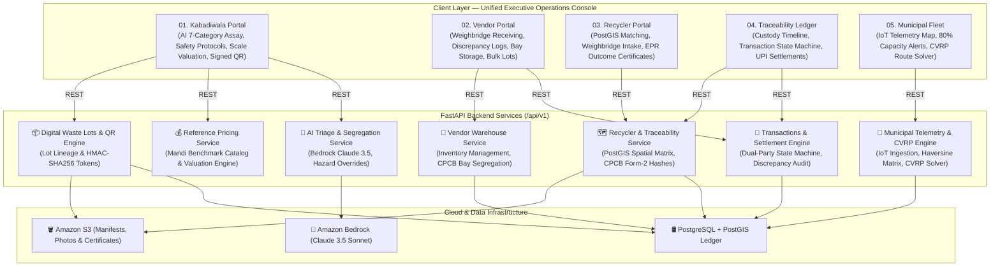
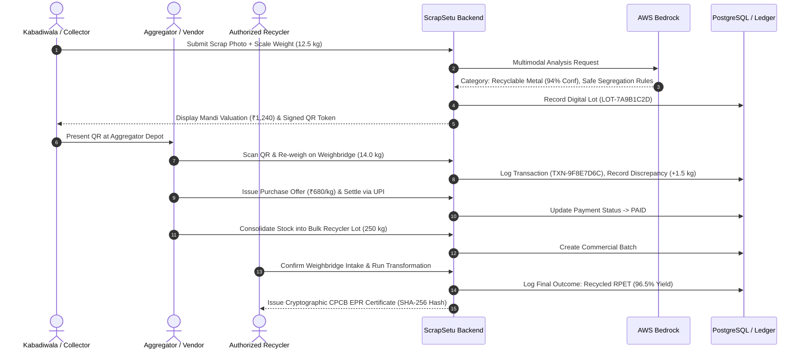

# ScrapSetu — Circular Resource Intelligence, Fair Transactions & End-to-End Traceability

[](https://www.python.org/)
[](https://fastapi.tiangolo.com/)
[](https://react.dev/)
[](https://www.typescriptlang.org/)
[](https://tailwindcss.com/)
[](https://postgis.net/)
[](https://aws.amazon.com/bedrock/)
[](backend/tests/)

**ScrapSetu** is an enterprise-grade circular resource intelligence platform built to formalize and digitize the scrap value chain across India. It connects **waste collectors (kabadiwalas)**, **aggregators / wholesale vendors**, **authorized recyclers / smelting mills**, and **municipal urban local bodies** through transparent market reference pricing, verified physical scale weighbridge measurements, cryptographic chain-of-custody tokens, and real-time IoT municipal fleet telemetry.

---

## Table of Contents

- [Core Value Proposition & Principles](#core-value-proposition--principles)
- [System Architecture](#system-architecture)
- [Interactive Portals & Workspaces](#interactive-portals--workspaces)
- [Subsystems & Capabilities](#subsystems--capabilities)
- [Data & Verification Flow](#data--verification-flow)
- [API Endpoints Reference](#api-endpoints-reference)
- [Technology Stack](#technology-stack)
- [Quick Start & Local Setup](#quick-start--local-setup)
- [Testing & Quality Assurance](#testing--quality-assurance)
- [Regulatory & Compliance Standards](#regulatory--compliance-standards)

---

## Core Value Proposition & Principles

1. **Zero AI Weight Guessing (Strict Physical Scale Measurements)**  
   ScrapSetu strictly avoids model-estimated or vision-guessed weights. Commercial settlements, lot creations, and compliance manifests strictly require **calibrated physical scale measurements ($W_{\text{actual}}$)** recorded on certified platform scales or weighbridges.

2. **Multimodal AI Material Assay & Deterministic Safety Overrides**  
   Powered by AWS Bedrock (Claude 3.5 Sonnet), materials undergo 7-category triage with instant safety containment overrides for hazardous items (swollen Li-ion batteries, chemicals, exposed high-voltage wiring, pressurized canisters) aligned with CPCB Schedule-III guidelines.

3. **Dual-Party Custody & Discrepancy Logging**  
   Every material handover requires verification by both sender and receiver. Any weight discrepancy between the sender's recorded scale weight and the receiver's weighbridge measurement is logged immutably rather than silently overwritten.

4. **Transparent Benchmark Reference Pricing**  
   Eliminates predatory middleman discounting by publishing live, transparent regional Mandi commodity indices and calculating fair net payable valuations using standardized formulas:
   $$\text{Net Payable} = (W_{\text{actual}} \times P_{\text{reference}}) - C_{\text{handling}}$$

5. **Municipal Fleet Telemetry & Smart Bin Dispatch**  
   Monitors municipal aggregation bins in real-time, flags 80% ultrasonic capacity breaches, and solves the Capacitated Vehicle Routing Problem (CVRP) to dispatch electric collection canters along minimum-distance trajectories.

6. **Cryptographic End-to-End Traceability**  
   Tracks waste lots from the initial collection point to final smelting or pelletization with HMAC-SHA256 signed QR handover tokens, immutable transaction states, and Extended Producer Responsibility (EPR) CPCB Form-2 certificates.

---

## System Architecture



---

## Interactive Portals & Workspaces

The platform features 5 operational workspaces sharing a design system built with **Plus Jakarta Sans**, **JetBrains Mono**, and responsive dark/light surface tokens:

| Tab | Portal / Workspace | Primary Persona | Key Functions |
|:---:|:---|:---|:---|
| **01** | **Kabadiwala & Collector Workbench** | Waste Pickers, Informal Collectors | Multimodal scrap triage, physical scale weight recording, Mandi index valuation, deterministic hazard alerts, and signed handover QR code generation. |
| **02** | **Vendor Portal & Warehouse Ledger** | Scrap Aggregators, Wholesale Yards | Incoming lots queue, receiver weighbridge verification, contamination deductions, storage bay segregation, and bulk onward batch creation. |
| **03** | **Recycler Portal & Recovery Ledger** | Authorized Smelting & Pelleting Mills | Nearby facility spatial matrix, weighbridge intake confirmation, recovery circularity yield calculation, and CPCB EPR audit certificate generation. |
| **04** | **Traceability & Audit Ledger** | Compliance Auditors, Corporate Producers | Step-by-step custody genealogy graph, full transaction history, discrepancy logs, and dual-state transfer/payment settlement tracking. |
| **05** | **Municipal Fleet & Smart Bin Dispatch** | Urban Local Bodies, Logistics Dispatchers | Live geospatial IoT bin map, 80% ultrasonic capacity breach detection, and Capacitated Vehicle Routing Problem (CVRP) route solver. |

---

## Subsystems & Capabilities

### 1. 🔍 AI Waste Classification & Segregation (7 Categories)
- **7 Classification Categories**: `biodegradable`, `recyclable`, `reusable`, `e-waste`, `hazardous`, `mixed`, `unknown`.
- **Segregation Guidance**: Recommends compatible and prohibited co-storage materials with environmental/safety rationale.
- **Deterministic Hazard Overrides**: Instant containment protocols for swollen Li-ion batteries, chemical leaks, exposed high-voltage wiring, and pressurized canisters. Low-confidence items are held at safe depot quarantine.
- **Physical Clarification**: Interactive multi-choice prompts to clarify grade and purity when confidence is medium.

### 2. ⚖️ Physical Scale Measured Valuation Engine
- **Zero AI Weight Estimation**: Weight entries are strictly populated via calibrated scale readouts.
- **Dynamic Fee Breakdown**: Transparent calculation showing gross value, handling deductions, and net payable payouts.
- **Mandi Price Benchmarks**: Live regional price catalog tracking copper, brass, aluminium, PET flakes, and battery scrap.

### 3. 🏪 Aggregator Warehouse Inventory & Bay Management
- **Designated Storage Bays**: Segregated bays (`Bay A-1`, `Bay B-2`, `Bay C-1`, `Bay E-1`) enforcing CPCB co-storage isolation rules.
- **Discrepancy Logging**: Automatic delta computation between sender claimed weight and receiver verified scale weight.
- **Bulk Batch Creation**: Consolidates multiple small collections into certified bulk lots for smelters.

### 4. 🏭 Recycler Facility Spatial Matrix & EPR Certificates
- **PostGIS Geofencing**: Computes real-world road distances to certified recycling plants.
- **Intake Hashes**: SHA-256 non-repudiable intake timestamps logged upon weighbridge verification.
- **Circularity Yield**: Calculates recovered material percentages and outputs CPCB Form-2 Extended Producer Responsibility (EPR) audit certificates.

### 5. 🚛 Municipal Fleet Telemetry & CVRP Route Solver
- **IoT Smart Bins**: Ingests weight and fill levels from ultrasonic/load cell sensors across Delhi-NCR.
- **Breach Detection**: Automatically triggers immediate dispatch orders when capacity reaches or exceeds **80%**.
- **CVRP Solver**: Solves the Capacitated Vehicle Routing Problem with capacity constraints (e.g. 350 kg EV Canters) to minimize distance and fuel consumption.

---

## Data & Verification Flow



---

## API Endpoints Reference

All endpoints are versioned under `/api/v1` and documented via OpenAPI Swagger at `http://localhost:8000/docs`:

| Domain | Method | Endpoint | Description |
|:---|:---:|:---|:---|
| **Health** | `GET` | `/health` | Health check endpoint returning system status and version |
| **Triage** | `POST` | `/api/v1/triage/analyze` | 7-category multimodal waste assay, segregation rules & hazard check |
| **Triage** | `POST` | `/api/v1/triage/clarify` | Collector clarification response for medium-confidence items |
| **Pricing** | `GET` | `/api/v1/pricing/catalog` | Verified market reference prices with source attribution |
| **Pricing** | `POST` | `/api/v1/pricing/calculate` | Valuation calculation based on verified physical scale weights |
| **Lots** | `POST` | `/api/v1/lots/create` | Creates digital waste lot with scale weight & location coordinates |
| **Lots** | `GET` | `/api/v1/lots` | Retrieve list of all active digital waste lots |
| **Lots** | `GET` | `/api/v1/lots/{lot_id}` | Retrieve specific waste lot metadata and custody history |
| **Handover** | `POST` | `/api/v1/handover/generate-qr` | Generates HMAC-SHA256 signed dynamic QR code payload |
| **Handover** | `POST` | `/api/v1/handover/verify-qr` | Validates signed QR token and retrieves lot metadata |
| **Transactions** | `POST` | `/api/v1/transactions/create` | Initiates formal waste transaction with unique `TXN-` ID |
| **Transactions** | `GET` | `/api/v1/transactions` | List all transactions with transfer & payment statuses |
| **Transactions** | `POST` | `/api/v1/transactions/{id}/confirm-receipt` | Receiver confirms scale weight & logs discrepancies |
| **Transactions** | `POST` | `/api/v1/transactions/{id}/update-payment` | Updates payment status (`PENDING`, `PAID`, `DISPUTED`) |
| **Transactions** | `POST` | `/api/v1/transactions/{id}/dispute` | Records formal transaction dispute without history overwrite |
| **Vendor** | `GET` | `/api/v1/vendor/dashboard` | Vendor warehouse inventory & storage bay breakdown |
| **Vendor** | `GET` | `/api/v1/vendor/incoming-lots` | Queue of incoming lots awaiting physical inspection |
| **Vendor** | `POST` | `/api/v1/vendor/inspect` | Records weighbridge measurement & issues purchase offer |
| **Vendor** | `POST` | `/api/v1/vendor/create-onward-lot` | Aggregates inventory stock into bulk onward lot for recyclers |
| **Recyclers** | `GET` | `/api/v1/recyclers/match` | Spatial matching of authorized recyclers via PostGIS |
| **Recyclers** | `POST` | `/api/v1/recyclers/intake-confirm` | Confirms intake on physical weighbridge & logs audit hash |
| **Recyclers** | `POST` | `/api/v1/recyclers/record-outcome` | Logs final recovery outcome & generates EPR certificate |
| **Recyclers** | `GET` | `/api/v1/recyclers/traceability/{lot_id}` | Complete chain-of-custody genealogy graph |

---

## Technology Stack

### Frontend Architecture
- **Framework**: React 19 with TypeScript and Vite
- **Styling**: Tailwind CSS v4 with bespoke CSS variable tokens (`--bg-surface`, `--text-primary`, `--border-subtle`)
- **Typography**: Plus Jakarta Sans (UI body & headings) and JetBrains Mono (metrics, hashes, coordinates)
- **Mapping & GIS**: Leaflet & React-Leaflet with custom map tiles and route polyline visualizers
- **Icons**: Lucide React
- **QR & Verification**: QRCode generator with base64 data URIs

### Backend Architecture
- **Framework**: FastAPI (Python 3.11+) with asynchronous ASGI server (Uvicorn)
- **Data Validation**: Pydantic v2 schemas and data contracts
- **Spatial Matrix**: PostGIS (Haversine distance calculation and coordinate boundary math)
- **Security**: HMAC-SHA256 signature generation for handover QR tokens

### Cloud & Machine Learning
- **AI Inference**: Amazon Bedrock (Anthropic Claude 3.5 Sonnet)
- **Spatial Storage**: PostgreSQL with PostGIS extension
- **File Storage**: Amazon S3 for digital certificates, inspection manifests, and scrap photos

---

## Quick Start & Local Setup

### Prerequisites
- Python 3.11 or higher
- Node.js 18+ and npm
- Git

### 1. Clone Repository
```bash
git clone https://github.com/your-org/Scrape-saathi.git
cd Scrape-saathi
```

### 2. Backend Setup
```bash
cd backend
python -m venv venv

# Activate Virtual Environment:
# On Windows (PowerShell):
.\venv\Scripts\Activate.ps1
# On Linux / macOS:
source venv/bin/activate

# Install Dependencies
pip install -r requirements.txt

# Start FastAPI Dev Server
uvicorn app.main:app --host 127.0.0.1 --port 8000 --reload
```
The FastAPI interactive documentation will be available at:
- Swagger UI: `http://localhost:8000/docs`
- ReDoc: `http://localhost:8000/redoc`

### 3. Frontend Setup
```bash
# In a new terminal window:
cd frontend
npm install

# Start Vite Dev Server
npm run dev
```
Open your browser at `http://localhost:5173`. The application automatically connects to the backend on `localhost:8000` with graceful offline fallback mock datasets.

---

## Testing & Quality Assurance

### Run Backend Unit & Integration Tests
```bash
cd backend
python -m pytest tests/ -v
```
All **7 test suites execute with 100% success**, verifying:
- Multimodal triage contracts and deterministic hazard overrides
- Formula-driven physical scale valuation calculations
- Unique lot generation and HMAC QR verification
- Dual-party transaction discrepancy detection
- Vendor warehouse inventory storage bay compliance

### Run Frontend Static Analysis & Type Checking
```bash
cd frontend
npm run lint    # Executes Oxlint
npm run build   # Verifies TypeScript compilation (tsc -b) & Vite bundle
```

---

## Regulatory & Compliance Standards

ScrapSetu is architected to satisfy Indian environmental and electronic waste regulations:
- **Plastic Waste Management (PWM) Rules 2024**: Full traceability from collection to registered pelletizers.
- **E-Waste Management Rules 2022**: Mandatory verification of certified dismantlers and hazardous component handling.
- **CPCB Schedule-III Mandates**: Enforces physical storage separation between incompatible materials (e.g. wet organics vs lead-acid batteries).
- **Extended Producer Responsibility (EPR) Form-2**: Generates tamper-proof SHA-256 signed audit records suitable for submission on the National CPCB EPR Portal.

---

## License

This project is licensed under the terms of the [LICENSE](LICENSE) file.
